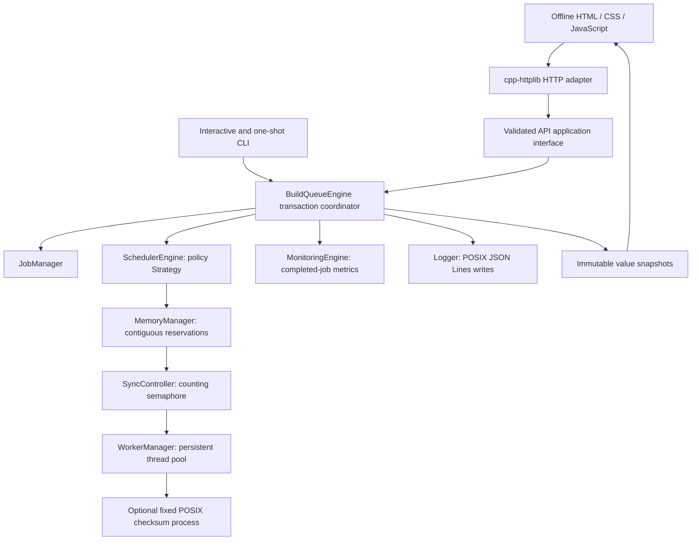

# BuildQueue architecture

**BuildQueue — An Intelligent Local Job & Resource Management System**  
Jaypee Institute of Information Technology · Operating Systems Lab · 24B15CS312 · PBL  
Arihant Jain (992401030014), Yuvraj Rana (992401030021), Siddharth Singh (992401030026), Batch F1  
Submitted to Dr. Ambalika Sarkar

## Three layers

Layer A owns scheduling, allocation, admission, state transitions and accounting. Layer B validates commands and maps errors; it does not implement policies. Layer C presents snapshots and sends commands; it never computes scheduling decisions. `Api::request` is transport-independent, so unit tests and real HTTP calls exercise the same application interface.

## A tick is a transaction

1. Admit future arrivals whose arrival tick has been reached.
2. Wake resource-blocked jobs in deterministic ID order when a slot and a suitable free block or retained reservation are potentially available; preserve policy ordering among eligible jobs.
3. For each free logical lane, consider READY jobs using the selected Strategy. Try one semaphore slot, then a contiguous memory reservation. Roll back a provisional slot if memory fails; move that job to WAITING and continue to other candidates.
4. Dispatch admitted jobs to free lanes and queue one work item per occupied lane to the persistent pool.
5. Wait for futures in lane order. Pool threads touch neither JobManager nor engine state; they execute assigned work and increment the atomic counter.
6. Charge READY and WAITING counters for the interval `[t,t+1)`. Record occupied and idle lanes, then advance the clock.
7. Admit boundary arrivals, release completed resources, and requeue unfinished RR jobs after new arrivals. Notify the coordinator condition variable.

An API reader sees the completed tick transaction, never a partial dispatch. HTTP serialization occurs after copying the snapshot and releasing the engine mutex. Physical pool thread identities are not CPU lanes; a lane is a deterministic simulation assignment, and any available pool thread may process its task.

## Ownership and lifetime

The engine owns its managers and holds the worker pool through a `unique_ptr`; a replacement pool is constructed successfully before a safe resize swaps ownership. The strategy and semaphore use `unique_ptr`; worker task ownership uses `shared_ptr<packaged_task>` only to bridge the queue's copyable callable requirement. Futures propagate task failures. The engine stops and joins its coordinator, then pool destruction drains queued tasks and joins all persistent threads. Live child processes are reaped inside the task before its future completes.

## OS concept-to-code mapping

| Concept | Class / function | Actual behavior |
|---|---|---|
| Process creation | `WorkerManager::execute` | `fork`, child `execve`, parent `waitpid` |
| Application process/job scheduling | `SchedulerEngine::order`, `makePolicy` | Four original policy strategies |
| Preemption | `BuildQueueEngine::stepLocked` | RR quantum releases lane and slot, requeues job |
| Context-switch-like events | `JOB_DISPATCHED`, `JOB_PREEMPTED` | Logical assignments; no kernel register-context switching |
| Threads | `WorkerManager::resize`, engine constructor | Persistent workers and one coordinator |
| Mutex | engine, MemoryManager, Semaphore, worker queue | Protect critical sections and coherent snapshots |
| Counting semaphore | `Semaphore::acquire/tryAcquire/release` | C++17 mutex/CV implementation with bounded permits |
| Condition variables | `WorkerManager`, `Semaphore`, `coordinate` | Predicate waits for queued work, permits and playback |
| Atomic counter | `SyncController::increment` | Every worker tick increments without lost updates |
| Memory allocation | `MemoryManager::allocate/release` | Exact splitting, ownership and coalescing |
| Fragmentation | `MemoryManager::snapshot`, fragmentation demo | Free-hole indicator and real denied request |
| Resource contention | `stepLocked` admission path | Denial events, WAITING reasons and blocked time |
| Deadlock prevention | engine admission and pool boundary | One-way lock graph; nonblocking reservations |
| Performance analysis | `MonitoringEngine::metrics`, `compare` | Logical times, occupancy, throughput, isolated replays |

No `ucontext`, signal timer scheduler, arbitrary `system()` call, JavaScript backend, or duplicated frontend scheduler is used. The tiny `SimulationClock` is header-only because its three operations do not warrant an empty `.cpp` module.

## Audit additions

The existing layer boundaries are retained. Snapshot metadata now includes `scenario`, `experiment_revision` and `logging`; comparison reports `source_revision`. The UI mutation gate serializes controls without adding a second scheduler. `web/js/exports.js` provides the metric serialization used by the actual export control and pure JavaScript tests.

HTTP socket options use `SO_REUSEADDR` for clean restarts while omitting `SO_REUSEPORT`, ensuring two independent engines cannot split requests to one dashboard port. The API returns structured JSON for malformed identifiers, unsupported methods and oversized bodies.
